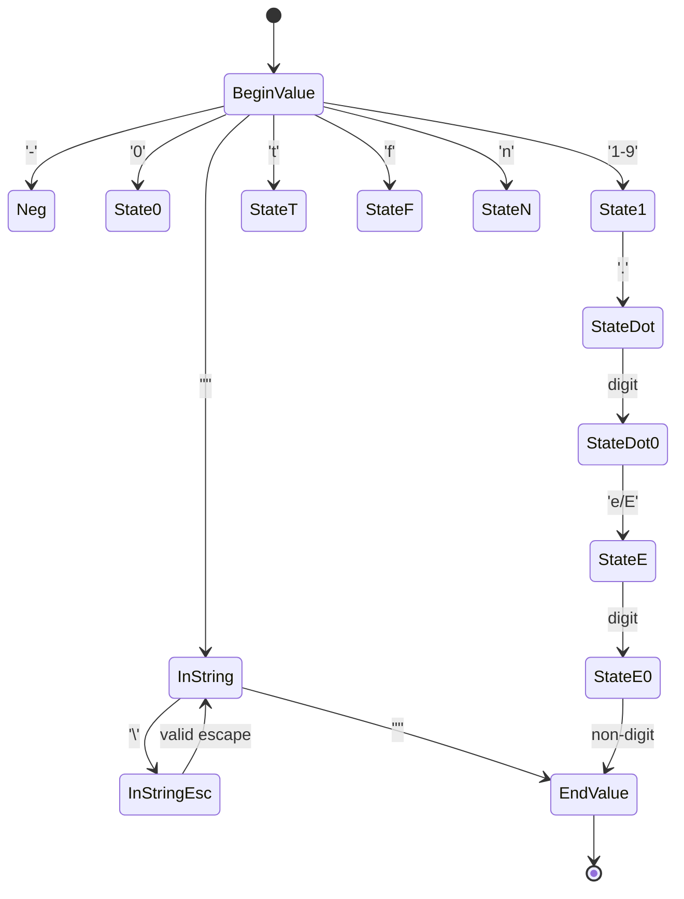
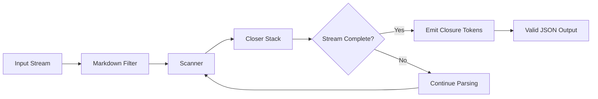

## The Problem: Re-parsing an Accumulated Buffer

When we talk about LLM "streaming," we're usually receiving data in small chunks via SSE (Server-Sent Events). A common naive approach in Go looks something like this:

1. Receive a new chunk.
2. Append it to an `accumulator` buffer.
3. Call `json.Unmarshal(accumulator, &target)`.
4. Update the UI/state.

While simple, this pattern has a quadratic cost. On every new chunk, the standard library scans the *entire* accumulated buffer again (`json.Unmarshal` checks the whole input for validity before it decodes anything). Sizes below are illustrative, one character per chunk:

```
Chunk 1: {"content": "H"           → Parse 15 bytes
Chunk 2: {"content": "He"          → Parse 16 bytes
Chunk 3: {"content": "Hel"         → Parse 17 bytes
...
Chunk N: {"content": "Hello..."    → Parse 14+N bytes
```

For a 10 KB response delivered in 100 chunks of about 100 bytes, that is 100 scans over a buffer that grows from 100 bytes to 10 KB: roughly 505 KB scanned in total instead of 10 KB. The cost grows with the square of the input. In the head-to-head benchmark further down, each ~4x increase in input size cost ~15x more time (4² = 16).

## The Solution: A Resumable State Machine

To solve this, I built [go-llm-stream](https://github.com/camilbenameur/go-llm-stream). Instead of re-parsing, it uses a **byte-level state machine** that processes each byte exactly once.

### State Machine Architecture

The scanner is adapted from the state machine inside Go's own `encoding/json` scanner. The change is that the state is an explicit enum instead of a function pointer, so it can be saved and restored between chunks. It has 31 states. Here is a simplified view of the transitions:



### The 31 States

The scanner tracks exactly where parsing stopped, organized into logical groups:

```go
// From scanner/state.go - the states, adapted from the Go stdlib scanner
const (
    // Value Entry States
    StateBeginValue         State = iota // Start of any value
    StateBeginValueOrEmpty               // After '[', expecting value or ']'
    StateBeginStringOrEmpty              // After '{', expecting key or '}'
    StateBeginString                     // Expecting object key

    // String Parsing States (6)
    StateInString      // Inside string literal
    StateInStringEsc   // After '\' in string
    StateInStringEscU  // After '\u'
    StateInStringEscU1 // After '\uX'
    StateInStringEscU2 // After '\uXX'
    StateInStringEscU3 // After '\uXXX'

    // Number Parsing States (8)
    StateNeg   // After '-'
    State0     // After leading '0'
    State1     // After non-zero digit
    StateDot   // After decimal point '.'
    StateDot0  // After decimal digits
    StateE     // After 'e' or 'E'
    StateESign // After exponent sign
    StateE0    // After exponent digits

    // Literal Parsing States - true (3)
    StateT   // After 't'
    StateTr  // After 'tr'
    StateTru // After 'tru'

    // Literal Parsing States - false (4)
    StateF    // After 'f'
    StateFa   // After 'fa'
    StateFal  // After 'fal'
    StateFals // After 'fals'

    // Literal Parsing States - null (3)
    StateN   // After 'n'
    StateNu  // After 'nu'
    StateNul // After 'nul'

    // Completion States
    StateEndValue // After completing a value
    StateEndTop   // After top-level value complete
    StateError    // Error state (terminal)
)
```

### How Resumability Works

When a chunk arrives, the scanner picks up exactly where it halted—mid-string, mid-number, or mid-object—and continues:

```go
// Chunk boundaries are invisible to the caller: the scanner keeps its state between reads
for token := range healer.Tokens() {
    process(token)
}
```

Each byte is scanned once, so the work grows linearly with the input, unlike re-parsing the accumulated buffer on every chunk. (`encoding/json.Decoder` is linear too; see the comparison below.) Because the state is a small value, the low-level `Scanner` can also save it (`Snapshot`) and load it back later (`Restore`), which is what lets you persist parser state mid-stream and resume from it.

## Allocations

Performance in Go isn't just about algorithmic complexity; allocations also cost GC work. go-llm-stream keeps its `Scanner`, `Tokenizer`, `Closer` and `Healer` objects, and the buffers they carry, in `sync.Pool`s so they are reused instead of reallocated. That does not make everything allocation-free. In the table below, the byte-level `Scanner` (fed a contiguous buffer), the `Closer` and the markdown stripping allocate nothing; the tokenizer, the readers and the healer still do.

### Benchmark Results

Selected results from the library's `docs/PERFORMANCE.md` (run on January 25, 2026: AMD Ryzen 5 7600X, Debian 12 inside a Dev Container, Go 1.24+; the container may cost some speed compared with bare metal). The document labels them v1.3.0, but the run predates that release (June 15, 2026), whose changelog reports fewer allocations for `StreamReaderSmall` (25 to 23 allocs/op). The document has 17 rows; I show the zero-allocation core first, then the higher-level pieces:

| Benchmark | Operations | ns/op | MB/s | B/op | allocs/op |
|:----------|:----------:|------:|-----:|-----:|----------:|
| ScannerSmall | 13,636,113 | 85.37 | 316.28 | 0 | 0 |
| ScannerMedium | 131,680 | 8,481 | 318.60 | 0 | 0 |
| Closer_Feed | 6,425,085 | 180.5 | 448.84 | 0 | 0 |
| StripMarkdown | 1,709,116 | 700.4 | 115.64 | 0 | 0 |
| TokenizerSmall | 3,910,642 | 316.9 | 85.20 | 184 | 9 |
| StreamReaderSmall | 418,035 | 2,953 | 14.56 | 5,061 | 25 |
| Healer_Healing | 1,317,870 | 898.1 | 89.08 | 160 | 2 |

**What this shows**: the byte-level `Scanner`, fed a contiguous buffer, allocates nothing and runs at about 316 MB/s. `ScannerSmall` pushes a 27-byte document through it byte by byte, so that is a small-input figure; `ScannerMedium`, on a larger generated document, gives about 319 MB/s. Once the input comes through a chunked `io.Reader` (`StreamReaderSmall`), throughput is 14.56 MB/s and it allocates. One MB/s figure does not show linear scaling; the scaling numbers are in the comparison below.

### A Stress Test

The stress test (`docs/examples/stress_test/main.go`) pushes 100,000 JSON objects (800,001 tokens, about 13 MB by my arithmetic) through the full `stream.NewHealer` pipeline over an `io.Pipe`. In the run recorded in `PERFORMANCE.md`:

- **Total Duration**: ~700ms (roughly 19 MB/s for the whole pipeline, including the test's own input generation; my arithmetic, not a figure from the benchmark doc)
- **Heap In Use**: ~4 MB, read once at the end of the run
- **Total Allocations**: ~890 MB, cumulative over the run

So the healer pipeline is not allocation-free: it allocated a lot in total, yet the heap in use at the end was small. I ran a single input size, so this shows the heap staying small on 13 MB of input, not that memory is constant at any size.

## Auto-Healing

One common issue with LLM outputs is that they can be cut off due to token limits or network errors, leaving you with invalid JSON like:

```json
{"status": "succe
```

### Before: Broken JSON

```go
// Plain json.Unmarshal - returns an error
resp := `{"status": "succe`
var result map[string]any
json.Unmarshal([]byte(resp), &result) // ❌ Error: unexpected end of JSON input
```

### After: Auto-Healed JSON

```go
// With go-llm-stream Healer
healer := stream.NewHealer(ctx, strings.NewReader(resp))
defer healer.Close()
for token := range healer.Tokens() {
    // ✅ Outputs valid tokens, auto-closes the string and object
}
// Reconstructed from the tokens: {"status": "succe"}  ← valid JSON, still cut off
```

The Healer maintains a stack of open delimiters (`{`, `[`, `"`) and automatically closes them when the stream ends prematurely. It also completes a partial literal (`tru` becomes `true`). The result is valid JSON, not the complete answer: the string above stays cut at `succe`, and a completed object key with no colon or value yet, as in `{"a"`, is given the placeholder value `"null"` (a string).



### Healer Configuration Options

```go
// From healer/healer.go (v1.3.0)
type HealerOptions struct {
    StripMarkdown      bool // Filter ```json code blocks
    AutoClose          bool // Auto-close unclosed containers
    IgnoreTrailingJunk bool // Ignore content after root closes
}
```

All three default to true. Closing unterminated strings and completing partial literals is part of what `AutoClose` does. An earlier version of this post listed two more options, `CompleteStrings` and `CompleteLiterals`. They were never wired up and were removed in v1.3.0, and `IgnoreTrailingJunk` did nothing until that release ([changelog](https://github.com/camilbenameur/go-llm-stream/blob/main/CHANGELOG.md)).

## Comparison with the standard library (corrected)

`encoding/json.Decoder`, the idiomatic streaming API, is O(n). It does not re-parse the buffer on each chunk. The quadratic blow-up only appears in the accumulate-and-re-parse pattern from the top of this post. To check, I benchmarked three approaches on the same input: one large JSON value (about 4 KB, 16 KB and 64 KB) delivered in 32-byte chunks (Windows 11, amd64, Ryzen 5 7600X, June 15, 2026; a different setup from the table above, a Windows host rather than a Linux dev container on the same CPU model, so absolute numbers do not compare across the two):

| Approach | 4,196 B | 16,494 B | 65,595 B | Growth per ~4x input |
|:---------|--------:|---------:|---------:|:---------------------|
| Naive re-parse of the accumulated buffer | 584,893 ns | 8,867,734 ns | 134,908,188 ns | ~15x (quadratic) |
| `encoding/json.Decoder` | 67,729 ns | 262,476 ns | 1,126,186 ns | ~4x (linear) |
| go-llm-stream `StreamReader` | 205,956 ns | 780,371 ns | 3,085,429 ns | ~4x (linear) |

Both streaming approaches are linear. `Decoder` is also faster in absolute terms: about 2-3x per operation in this benchmark (1.13 ms against 3.09 ms at 65,595 bytes), although `StreamReader` does relatively better with 64-byte chunks. So I would not pick go-llm-stream for speed. It earns its place where the standard library has no equivalent: healing truncated or markdown-fenced output, and saving and restoring scanner state. `Decoder.Token` can also read a stream token by token, but it cannot repair broken input or resume from saved state.

## Usage

```go
import "github.com/camilbenameur/go-llm-stream/stream"

// responseBody is an io.Reader of (possibly truncated or fenced) model output
// containing a JSON value, for example a structured-output response.
healer := stream.NewHealer(ctx, responseBody)
defer healer.Close()

for token := range healer.Tokens() {
    if token.Kind == stream.TokenString {
        fmt.Print(string(token.Raw)) // each string token, once it is complete
    }
}
```

For raw OpenAI- or Anthropic-style SSE responses, the `openai` package decodes the events and hands you the content deltas (`openai.NewStream(ctx, body)`, then `NextDelta()`); see `docs/examples/openai` in the repo.

## Conclusion

go-llm-stream is a small library that does a couple of things the standard library does not: it repairs truncated or fenced JSON, and it can save and restore scanner state. It also emits fields as they complete, which `Decoder.Token` can do token by token as well. In my benchmark it is slower than `encoding/json.Decoder` on chunked input, and the benchmarks above only cover the parser: they say nothing about end-to-end latency or CPU use in an LLM application.

The main design decisions:

1. **State Machine Design**: 31 enumerated states replace function pointers so the state can be saved and restored
2. **Pooled objects**: `sync.Pool` for the Scanner, Tokenizer, Closer and Healer; in the benchmarks above the scanner, closer and markdown stripping allocate nothing, while the tokenizer, the readers and the healer still do
3. **Defensive Healing**: Stack-based delimiter tracking to close truncated output
4. **Linear scanning**: Each byte is scanned once
5. **Fuzz testing**: the scanner and healer are fuzz-tested and cross-checked against `encoding/json.Valid`; fuzzing found real bugs (numbers inside containers, dangling object keys), fixed in v1.3.0

If you need to repair truncated or fenced LLM JSON, read fields before a value is complete, or resume from saved scanner state, the project is on GitHub: **[go-llm-stream](https://github.com/camilbenameur/go-llm-stream)**. If your JSON is well-formed, `encoding/json` is the better tool.

## Changes to this post (2026-09-29)

The note at the top of the page gives the main correction. These are the other main changes:

- the title, which promised an optimization result the benchmarks do not support
- the comparison with the standard library: the table I originally showed (about 500 parses for 1 MB) was never benchmarked, and it is replaced by measured numbers
- the Healer options: two of the five I listed were never wired up and were removed in v1.3.0, and a third, `IgnoreTrailingJunk`, did nothing until that release
- the state count (31, not 27) and the credit to the standard-library scanner it is adapted from
- the `sync.Pool`, zero-allocation and memory claims, and the benchmark conditions
- the arithmetic in the re-parsing example, which was off, and the description of the stress test
- the usage sample, which did not compile
- a claim about lower CPU usage and latency, which I never measured

Details and numbers: [PERFORMANCE.md](https://github.com/camilbenameur/go-llm-stream/blob/main/docs/PERFORMANCE.md#comparison-with-the-standard-library-corrected).

---

*I'm Camil, a software engineer in Nice, France. You can find me on [GitHub](https://github.com/camilbenameur) and [LinkedIn](https://www.linkedin.com/in/camil-benameur-14a762194/).*
