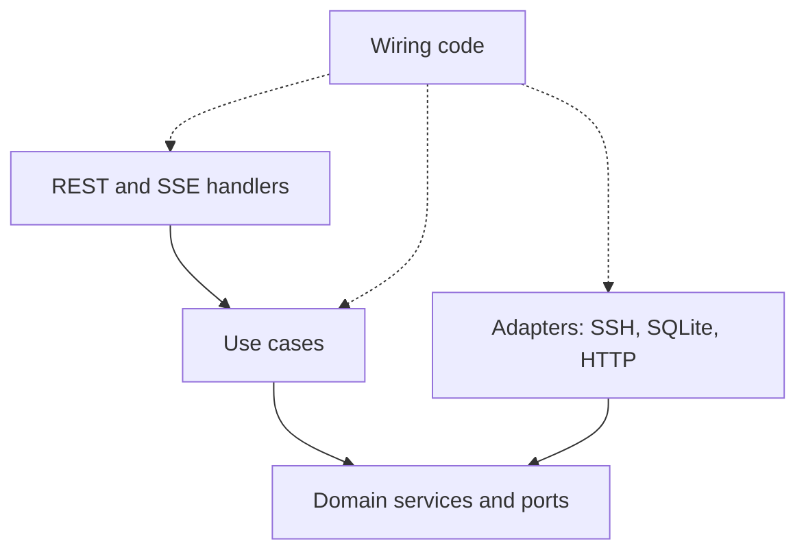
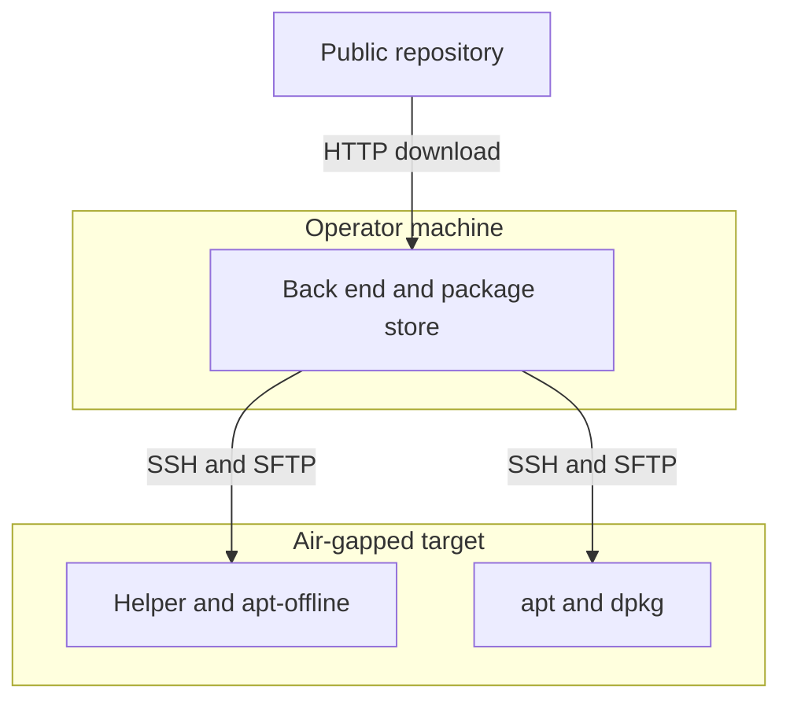

## What the Installer Has to Do

This post looks inside the installer I described in [the February post](/blog/from-backlog-to-offline-installer/). It deploys industrial automation software onto industrial PCs that often have no internet access, and it does so over SSH. This is how I built it, and what I would judge differently now.

The targets are apt-based Linux machines reachable over SSH. Often the operator's machine is the only one with internet access, so it acts as a relay: it downloads packages and pushes them to the target. If the target is online, apt resolves dependencies itself.

A full run has seven steps: an SSH test, a connectivity check, a tooling install, Docker, an introspection of what is missing, a dependency install, and the product install. Live progress reaches the browser through Server-Sent Events, not WebSockets. The back end is large, and that size is part of the story.

## Four Layers and a Dependency Rule That Held

The back end has four layers: domain, application, infrastructure, and the REST interfaces. The import direction held: the domain depended on nothing else, and the REST layer did not reach into infrastructure directly. The exceptions were the wiring code and a few places that read global configuration.



The ports are where the design is most visible. SSH access is split into small ports (connection, command, file transfer and so on), and most consumers ask only for the narrow composite they need. On top sit dozens of capability ports that speak the domain's language, such as "check Docker installation".

One thing I noticed late: a lot of orchestration logic ended up in domain services rather than in use cases, so the domain grew heavy. The layers stayed separate, but the responsibilities inside them blurred, and nothing enforced the rule as a check.

### One Request Through the Layers

A status request passes the HTTP middleware and reaches a typed handler, which calls a use case. From there it goes through a repository, a domain service, a port and an adapter that runs a command on a pooled SSH client. That is a lot of hops for one question. The layering is real, and so is the cost of reading it.

## The Install Pipeline and Live Progress

The pipeline is an application-layer use case that runs the seven steps in order. It stops at the first error and has no rollback. Recovering means running it again, and steps already satisfied (tooling, Docker, dependencies) are skipped. Every step goes through one wrapper that emits `running`, then `completed`, `skipped` or `failed` with a duration. Each event is saved to SQLite, written to the HTTP stream of the run that triggered it, and published to an in-process hub for every other window.

Two details are worth keeping.

**The job outlives the request.** The pipeline is detached with `context.WithoutCancel`, added after a bug: a client disconnect cancelled the request context and aborted the last install step. A per-device guard rejects a second run for the same device, and because the HTTP status is already sent once the stream starts, the rejection travels as an event inside the stream.

**POST streams need `fetch`.** The browser's `EventSource` only supports GET. The install needs a POST body, so the front end reads the response with `fetch` and a stream reader and splits the SSE blocks itself.

The limits are plain. Substeps are static labels, not real progress, slow subscribers can miss events, and "Cancel" in the UI aborts the browser's `fetch`, not the install, because the job is detached on purpose.

## Surviving apt and dpkg Locks

On a freshly booted machine, apt and dpkg locks are often held by background updaters, so installs fail for reasons unrelated to the packages. The installer recognises a lock conflict by matching known message phrases against the error text. Anything else returns immediately. The retry uses exponential backoff with jitter, bounded to a handful of retries, and stops early when the context is cancelled.

```go
// Simplified sketch, not the original code.
func retryOnLock(ctx context.Context, maxRetries int, base time.Duration, op func() error) error {
	for attempt := 0; ; attempt++ {
		err := op()
		if err == nil || attempt >= maxRetries {
			return err
		}
		if !looksLikeLock(err.Error()) {
			return err
		}
		wait := base<<attempt + jitter(base)
		select {
		case <-ctx.Done():
			return ctx.Err()
		case <-time.After(wait):
		}
	}
}
```

The Docker step adds a ladder on top: retry, then a best-effort repair routine, then an alternative installer that installs the packages in a fixed order. One small gotcha in the "apt is busy" status flag: on many Ubuntu systems `unattended-upgrades` looks active only because of an idle shutdown helper, so the probe has to filter that helper out.

## The Offline Relay: Packages for a Device With No Internet

This is the deepest part of the system. The operator machine downloads over HTTP and pushes files by SFTP. The target only needs SSH.



### Reading the Target

The back end reads the OS name, version, codename and architecture from the target, and builds repository paths and `.deb` file names from those. The download path only knows the Ubuntu repository layout.

### Pinned Versions, Partly

Only the two core Docker packages were pinned, and only as a default; the supporting packages resolved to the latest. The local package store did not always distinguish versions, so a stored package could be reused for another version.

### The Manifest and the Dependency Walk

In apt-offline, a "signature" is a manifest. The helper asks apt what it would download to install a package on the target, and because apt computes this against the target's real package state, the manifest lists only what is missing there. This runs with the network disabled.

The resolver walks a growing queue of packages, preferring an uploaded `.deb`, then the local store, then a download, and treats anything unresolved as a warning. The install is then a single `apt install` of the staged files, wrapped in the lock retry described above.

## The Shell and the Test Environment

The Tauri 2 shell is a thin piece of Rust. It starts the Go back end as a bundled sidecar and kills it when the main window closes. Builds live in one multi-stage Dockerfile, and the Windows installer is built from Linux. The shell has gaps: no readiness check, and nothing restarts the back end if it dies.

For device behaviour, the test environment is a Docker Compose file with containers running systemd and an SSH daemon: Ubuntu and Debian, each with an "online" and an "offline" variant. The offline ones sit on a network declared `internal`, so they have no route out, which approximates an air-gapped target.

In Go, the tests use hand-written fakes for the ports, with function fields so a test stubs only what it needs. Coverage was thin where it mattered: real SSH behaviour was mostly tested by hand, and the front-end end-to-end tests were not part of an automated pipeline.

## Volume Outran Review

Now the second half. A back end this large was hard to keep coherent, and it showed.

**Built but never wired.** A sizeable amount of Go was never called. One example is an alternative bulk implementation with no caller, because the live bulk feature composed the REST handlers instead. Some front-end code was never used either. I only noticed it late.

**A seam left open.** The Docker installation service had dependencies that were never injected, with a fallback path that ended up being the one that actually ran.

## Three Ways to Wire One Application

The application was wired in three ways at once: a long composition function that builds things inline, a fluent factory that builds most of the use cases, and an adapter registry, plus package-level state for configuration. The result was duplicated instances. The adapters are thin and stateless, so those duplicates were harmless, but some services ended up built more than once, and their state was not shared.

The tests did not help. Some tests only checked that things existed, which protects the shape of the code, not its behaviour, and can freeze dead code in place. Nothing exercised the full wiring, so a wiring mistake would not fail a test.

## When Green Did Not Mean Passing

This section is about steps that reported success on failure. On this project, a progress screen that shows green on a failed step is worse than none.

Step outcomes were reported inconsistently, so a step could show green even though something had failed, and the retry layer could not always tell a dead connection from a failed command.

```go
// Illustrative sketch of what I would write, not project code.
type Result struct {
	ExitCode int
	Stdout   string
	Stderr   string
}

// Run returns an error only when the transport fails.
type Executor interface {
	Run(ctx context.Context, cmd string) (Result, error)
}

func statusOf(res Result, err error) Status {
	switch {
	case err != nil:
		return Retryable // safe to retry on a fresh connection
	case res.ExitCode != 0:
		return Failed // an answer: do not re-run blindly
	default:
		return Succeeded
	}
}
```

Build and CI checks were too permissive: some failures did not stop the pipeline, and CI arrived late.

## Building With AI Coding Agents: What It Left Behind

The project carried agent instructions and a lot of planning material. I make no claim about how much of the code agents wrote. What I can describe is what they left behind.

The visible effect was volume. By the end, the planning notes had grown very large and two planning systems coexisted. Someone has to read that and keep it in sync.

A plan can also be wrong in a quiet way. One plan assumed the request context could simply be passed through the pipeline. The SSH client does not read its context, but other layers did, so a browser disconnect aborted the last install step, the bug behind the detached job described earlier. A plan written quickly needs a step that checks its assumptions against the code.

Rules written in an instruction file were not always followed by the code. A written rule shows intent, not compliance, and responsibility stays with the engineer.

## What I Would Do Differently

These are scoped to this project.

1. **Make CI blocking from the first commit.** Start with a small set that can fail, and keep report upload separate from the exit code. A check that cannot fail is a report, not a gate.
2. **Finish one vertical slice, then write one composition root.** Build a single feature end to end before the layers around it, and build each shared service once, with a test that asserts it.
3. **Require ports at construction.** A constructor that rejects `nil` turns a quiet TODO into a startup failure. Add dead-code detection so "constructed but unreferenced" fails a check.
4. **Make outcomes data.** One failure channel per layer, retry only on transport errors, and pass the context into the SSH call so timeouts actually bind.
5. **Turn written rules into checks.** A short import-graph test would catch layer drift that comments cannot.
6. **Keep one planning system.** Prune it per milestone, keep generated notes out of the main tree, and keep a one-page README as the contract.

The takeaway is narrow. On this project the layer boundaries held, mostly by convention. The things that depended on discipline alone drifted: wiring, step status, CI.

---

*I'm Camil, an engineer in Nice, France. You can find me on [GitHub](https://github.com/camilbenameur) and [LinkedIn](https://www.linkedin.com/in/camil-benameur-14a762194/).*
