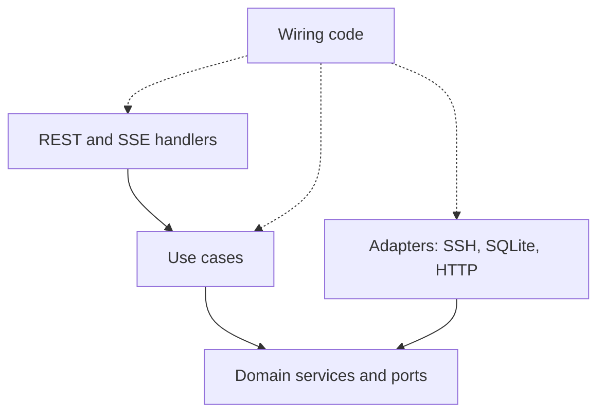
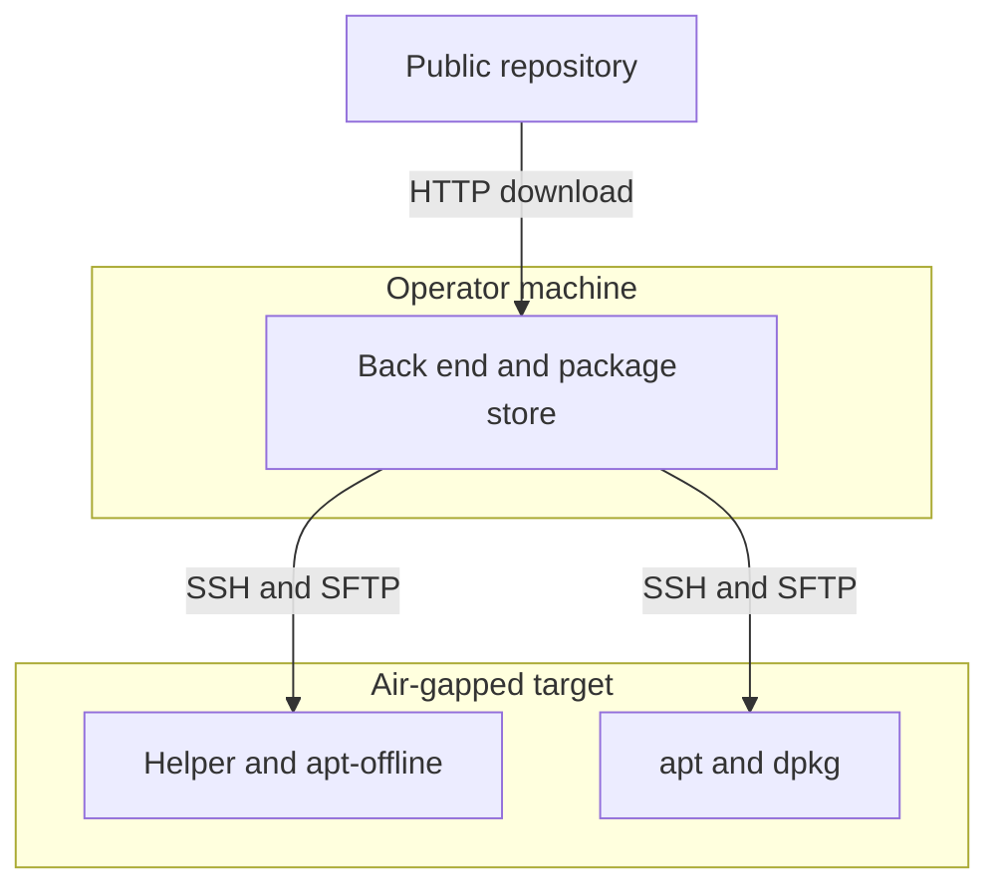

## What the Installer Has to Do

This post looks inside the installer I described in [the February post](/blog/from-backlog-to-offline-installer/). It deploys industrial automation software onto industrial PCs that often have no internet access, and it does so over SSH. Everything below describes the code as it stood in March 2026, plus what I notice in it now.

The installer assumes apt-based Linux targets reachable over SSH. Often the operator's machine is the only one with internet access, so it acts as a relay: it downloads packages and pushes them to the target. The installer probes the target, and if the target is online, apt resolves dependencies itself.

A full run has seven steps: an SSH test, a connectivity check, a tooling install, Docker, an introspection of what is missing, a dependency install, and the product install. Live progress reaches the browser through Server-Sent Events, not WebSockets. A 30-second polling fallback for device status runs while the stream is down.

For size: the back end is about 56k lines of Go, excluding tests, in the March 2026 snapshot (`wc -l`, so blanks and comments are included). The tests add about 13k more. I come back to those numbers in the second half, because they are part of the story.

## Four Layers and a Dependency Rule That Held

The back end has four layers: domain, application, infrastructure, and the REST interfaces. These are their sizes on the snapshot, counting non-test Go only.

| Layer | Non-test Go lines | What lives there |
|:---|---:|:---|
| `domain` | 19,363 | entities, ports, services |
| `infrastructure` | 19,974 | adapters, SQLite, SSH pool |
| `application` | 9,012 | use cases, wiring, one worker |
| `interfaces` | 6,928 | ten REST feature packages |

*Method: `wc -l` over non-test `.go` files per layer folder under `internal/`, March 2026 snapshot. The remaining 648 lines of the 55,925 are in `cmd/` and other top-level folders.*

The domain services folder alone is 12,776 lines, which is more than the whole application layer. Orchestration logic lives in "domain services" rather than in use cases. The size of each layer shows where the logic really sits.

The dependency rule itself held. In non-test code, the domain imports no other internal layer and no third-party package. Infrastructure imports only the domain. The REST layer never imports infrastructure. The exceptions are the composition code and factory, one use case that imports an infrastructure helper, and a few domain files that read global configuration.



The ports are where the design is most visible. SSH access is split into six small ports (connection, command, file transfer, directory, permission, package) plus three composites. One adapter implements all six, and most consumers ask only for the narrow composite they need. On top of that sit about 25 capability ports that speak the domain's language, such as "check Docker installation", each built on the transport-level ports.

That is also where the over-building starts, but I will get to it. For now: the rule held in the snapshot, and nothing enforced it as a check.

### One Request Through the Layers

A simple status request shows how the layers connect. It enters the HTTP server, passes the logging and panic-recovery middleware, and reaches a typed handler. The handler calls a use case, which loads the device through a repository port backed by SQLite. The use case calls a domain service, then a capability port, then an adapter, which runs a command on a pooled SSH client.

That is about ten hops for one question, and a single Docker status request fans out into up to five sequential SSH commands. The layering is real, and so is the cost of reading it. Two details of the HTTP stack (`Huma v2` on top of `gorilla/mux`) are worth knowing:

- **Route order matters.** `gorilla/mux` matches in registration order, so the event and bulk routes must be registered before routes with a wildcard segment. The rule lived only in comments.
- **Middleware can break streaming.** The logging middleware wraps the response writer. It has to forward `Flush()`, or Server-Sent Events are buffered until the response ends.

## The Install Pipeline and Live Progress

The pipeline is an application-layer use case that runs seven existing use cases in order. It does not run steps in parallel, and it stops at the first error. There is no rollback. Recovering from a failed run means running the pipeline again, and some steps that are already satisfied (tooling, Docker, dependencies) are skipped. The steps are code, not data.

Every step goes through one wrapper. It emits `running`, calls the step, then emits `completed`, `skipped` or `failed` with a duration. Each event goes three places, in this order: it is saved to SQLite, written to the HTTP stream of the run that triggered it, and published to an in-process hub.

Simplified sketch, not the original code:

```go
// Simplified sketch, not the original code.
func (p *Pipeline) runStep(name string, fn func() (bool, error)) error {
	p.emit(Event{Step: name, Status: "running"})
	start := time.Now()
	skipped, err := fn()
	status := "completed"
	if err != nil {
		status = "failed"
	} else if skipped {
		status = "skipped"
	}
	ev := Event{Step: name, Status: status}
	ev.Ms = time.Since(start).Milliseconds()
	p.emit(ev)
	return err
}

func (p *Pipeline) emit(ev Event) {
	p.store.SaveLatest(ev) // 1. persist the latest state
	_ = p.stream.Send(ev)  // 2. this run's HTTP stream
	p.hub.Publish(ev)      // 3. every other window
}
```

Some details are worth keeping.

**The job outlives the request.** The pipeline is detached with `context.WithoutCancel`, added after a bug: a client disconnect cancelled the request context and aborted the last install step with `context canceled`. A per-device `sync.Map` guard rejects a second run for the same device. Because the HTTP status is already sent when the stream starts, the rejection travels as an event inside the stream.

**POST streams need `fetch`.** The browser's `EventSource` only supports GET. The install needs a POST body, so the front end reads the response with `fetch` and a stream reader, and splits the SSE blocks itself. The global device stream does use `EventSource`.

**Slow subscribers lose events.** The hub gives each subscriber a buffered channel of ten events. Publishing never blocks, so a slow subscriber silently drops events. A new subscriber is seeded with the latest terminal state of each device, read from SQLite.

The limits are plain. Substeps are three static labels, not real progress. After a page refresh, the UI shows a state reconstructed from one stored row per device, not a replay. And "Cancel" in the UI aborts the browser's `fetch`, not the install, because the job is detached on purpose.

## Surviving apt and dpkg Locks

The installer uses reactive fallback and retry for apt locks and dependency resolution. In code, a lock conflict is recognised by matching a list of known message phrases against the error text, which already contains stderr. Anything that is not a lock error returns immediately.

The retry waits 2, 4, 8, 16 and 32 seconds, plus less than a second of jitter, for up to five retries. Between attempts it makes a best-effort wait for the package manager to go idle. It stops early when the context is cancelled.

Simplified sketch, not the original code:

```go
// Simplified sketch, not the original code.
func retryOnLock(ctx context.Context, op func() error) error {
	const maxRetries = 5
	for attempt := 0; ; attempt++ {
		err := op()
		if err == nil || attempt == maxRetries {
			return err
		}
		if !looksLikeLock(err.Error()) {
			return err
		}
		backoff := time.Duration(1<<(attempt+1)) * time.Second
		wait := backoff + jitter(time.Second)
		select {
		case <-ctx.Done():
			return ctx.Err()
		case <-time.After(wait):
		}
	}
}
```

The Docker step adds a ladder on top: retry, then a repair routine of best-effort commands, then an alternative installer that installs the packages in a fixed order. That is the shape of it, and I will leave the details out.

A separate status probe flags "apt is busy" for display. It has one small gotcha. On many Ubuntu systems the `unattended-upgrades` service looks active only because of an idle shutdown helper. The probe reads the service's main process command line and filters that helper out, and a unit test covers the case. The flag is informational: the pipeline never reads it.

## The Offline Relay: Packages for a Device With No Internet

This is the deepest part of the system. The operator machine does the downloading over HTTP and pushes files by SFTP. The target only needs to be reachable over SSH.



### Reading the Target

The back end reads `/etc/os-release` for the name, version and codename, and `uname -m` for the architecture. It maps the architecture to the Debian name (`x86_64` to `amd64`, `aarch64` to `arm64`). The repository path and the `.deb` file names are then built from the codename, the version and the architecture. The Go download path only knows the Ubuntu repository layout, so "different Ubuntu releases" is the fair description, not the "different distros" I wrote in February. Debian passes the OS check and is in my test lab, but the Docker URLs are Ubuntu-shaped.

### Five Packages, Two Pins

The Docker install fetches five packages. `docker-ce` and `docker-ce-cli` are pinned to a version. The other three (`containerd.io` and the buildx and compose plugins) are resolved as "latest" by reading the vendor's directory listing with a regular expression and sorting by semantic version.

The 27.5.1 pin is a default constant. It applies when the request names no version, and the pipeline never names one. So the pinning in my February post was true for two packages, and only as a default.

The local store taught me a small lesson. It is keyed by operating system, architecture and package name, but not by version. The table's unique index included the version, and the query did not. A stored `docker-ce` of one version would be reused when another version was requested. I would now write the lookup first and let the index follow it.

One more small detail. The reachability probe before a download is a `GET` with `Range: bytes=0-0`, not a `HEAD`, using the same HTTP client as the real downloads.

### The Manifest From the Target

In apt-offline, a "signature" is a manifest. The helper runs `apt --print-uris install X` on the target, and apt lists the files it would download. Because apt computes this against the target's real package state, the manifest lists only what is missing there. The helper runs this under `unshare -n`, an empty network namespace, so apt cannot touch the network.

For the Docker `.deb` files themselves, dependencies come from their own control fields. One batched SSH call runs `dpkg-deb -f` on every uploaded file, because those files are not in the target's apt sources.

### Walking the Dependencies

The resolver is a queue walk over a list that grows while it runs. Each package is checked in a fixed priority order: provided (an uploaded `.deb`), then the local store, then the manifest and a download, then a local inspection, and finally recorded as unresolved. Control fields are read only for the uploaded Docker packages and for locally inspected ones. Downloaded packages are not inspected, because the manifest already lists the missing closure.

Deduplication happens at four levels: on the request list, in a seen set during the walk, through the primary key of the database table, and by first-wins lookup when the manifest is turned into a map.

Simplified sketch, not the original code:

```go
// Simplified sketch, not the original code.
queue := dedupe(requested)
seen := setOf(queue)
for i := 0; i < len(queue); i++ { // the queue grows during the walk
	pkg := queue[i]
	switch {
	case provided.Has(pkg): // uploaded .deb: read its control fields
		queue = addNew(queue, seen, controlDeps(pkg))
	case store.Has(pkg):
		upload(store.Path(pkg))
	case manifest.Has(pkg):
		upload(download(manifest.URL(pkg)))
	case inspectLocally(pkg): // a .deb found on disk
		queue = addNew(queue, seen, localDeps(pkg))
	default:
		unresolved = append(unresolved, pkg) // only a warning
	}
}
```

The install is then one `apt install ./*.deb` in the staging directory, wrapped in the lock retry from the previous section. The target-side helper is shell plus Python, and the Go side calls only two of its subcommands (introspect and generate signatures). The remaining subcommands have no caller in the Go code.

## The Shell and the Test Environment

The Tauri 2 shell is about a hundred lines of Rust. It starts the Go back end as a bundled sidecar, mirrors the sidecar's output into the app log, and kills the process when the main window closes. The UI talks to the back end over HTTP and Server-Sent Events. All builds live in one multi-stage Dockerfile, the Makefile extracts artifacts from the image, and the Windows NSIS installer is built from Linux. The shell has gaps: a missing sidecar panics the app at startup, there is no readiness check and no restart if the back end dies, and the Rust crate has no tests.

The test environment for device behaviour is a Docker Compose file with four containers running systemd and an SSH daemon: Ubuntu 22.04 and Debian 12, each with an "online" and an "offline" variant. The offline ones sit on a network declared `internal`, so they have no route out. That approximates an air-gapped target. The repository also holds bash scripts meant to be run by hand against the containers.

In Go, the tests use hand-written fakes for the ports, with function fields so a test stubs only what it needs. Three REST test files build a real Huma API on a `gorilla/mux` subrouter and call it through `httptest`.

The measured picture is thin. The snapshot has 269 top-level test functions (a grep for `func Test`), and 23 of the 64 Go packages have at least one test file. The suite was not run for this post, so I state no coverage figure. No automated Go test opens an SSH connection.

On the front end there are 8 Vitest files and 67 Cypress tests. The Cypress specs stub the API with `cy.intercept`, and no pipeline runs them.

## Volume Outran Review

Now the second half. Each item follows the same pattern: what was measured, what it caused, and what I would do.

**Observation.** About 56k lines of Go for a back end whose headline flow is a seven-step pipeline, plus a device registry, scanning, bulk operations and uninstall. The domain declares 62 port interfaces. A method of the use-case factory carries a comment claiming the adapter registry is built a single time, yet it builds 25 new adapters on every call, from 16 call sites.

**Built but never wired.** A file-level scan (constructors with no caller outside tests) finds roughly 3.7k lines, about 7% of the Go, that nothing constructs. A 592-line bulk-operations use case has its own 411-line test file and no caller, because the live bulk feature composes the REST handlers instead. On the front end, a reachability script over imports found 23 of 85 source files, about 14% of the lines, unreachable from the entry point.

**A seam left open.** The Docker installation service takes four dependencies and sets eight declared ports to `nil`, each marked with a TODO to inject it later. Nineteen `if port != nil` branches then fall back to shell command strings built inside the domain service. By reading the code, the live path always takes the fallback. The first TODO of that kind dates from August 2025 in the history, and it was still there at the last commit.

**What held.** The import direction held, and some cleanup did land: deprecated front-end contexts and a deprecated adapter are gone from the tree. The responsibilities inside the layers blurred, though, and wiring was left unfinished.

| Intended | Found | How it was checked |
|:---|:---|:---|
| Every operation behind a port | One Docker service with 8 `nil` ports and 19 shell fallbacks | read the constructor, counted the guards |
| One wiring path | Three mechanisms (next section) | read the composition code |
| Bulk implemented once | Twice, one copy has no caller | grep for callers |
| Code that is used | About 3.7k Go lines constructed nowhere | file-level scan, not a compiler result |

What I would do: finish one vertical slice end to end before building the layers around it, and make "constructed but unreferenced" fail a check. Those are items 2 and 3 in the final list.

## Three Ways to Wire One Application

The application is wired in three ways at once. The first is a composition function of about 540 lines that builds things inline. The second is a fluent factory of about 800 lines that builds 12 of the 14 use cases wired there. The third is an adapter registry. A fourth, implicit mechanism is package-level state: the configuration package reads the environment when the process starts, and `main` registers embedded packages through global setters.

The result is duplicated instances. The adapter registry is constructed three times, and the download coordinator and the package-store service twice each. The adapters are thin and stateless, so the duplicates look harmless. The coordinator state is split between the Docker path and the generic path, though.

The tests do not help here. Two reflection tests assert that fields and methods exist, and one of them requires two factory methods that nothing calls. No test builds the container, so a wiring mistake would not fail any test. A test that asserts a field exists protects the shape of the code, not its behaviour, and it can freeze dead code in place.

What I would do: one composition root, written early, with services built exactly once and a test that says so.

## When Green Did Not Mean Passing

This section is about steps that reported success on failure. On this project, a progress screen that shows green on a failed step is worse than none.

The step use cases reported failure in three different ways: a returned error, a `Success` boolean, and a status string. The pipeline checked the first two. The dependency-install use case returns a result with an overall status of `FAILED` and a `nil` error on several paths. The coordination layer treats `nil` as success, so the step can be reported `completed` when every dependency failed.

A package tarball install sets its success flag before a required post-install initialization command runs. If that command fails, the function returns the result with a message and a `nil` error, and the pipeline reports the step as done. Elsewhere, a transport error can turn into "not installed", and a failed command can be run twice, because the retry layer cannot tell a dead connection from a non-zero exit code.

Illustrative sketch of what I would write, not code from the project:

```go
// Illustrative sketch of what I would write, not project code.
type Result struct {
	ExitCode int
	Stdout   string
	Stderr   string
}

// Run returns an error only when the transport fails.
type Executor interface {
	Run(ctx context.Context, cmd string) (Result, error)
}

func statusOf(res Result, err error) Status {
	switch {
	case err != nil:
		return Retryable // safe to retry on a fresh connection
	case res.ExitCode != 0:
		return Failed // an answer: do not re-run blindly
	default:
		return Succeeded
	}
}
```

The build and CI had the same shape.

- A back-end build prints a success message and exits 0 after one platform failed, as long as another platform built.
- The desktop build, by my reading of the script, writes `FAILED` into a summary file and still exits 0 unless a `--fail-fast` flag is given.
- A CI guard meant to catch "no `.deb` downloaded" counts lines with `echo "$files" | wc -l`. With no files, `echo` still prints a newline, so the count is 1 and the guard passes. The step only fails afterwards, because `mv` gets an empty source.
- Seven lint and test commands in the quality pipeline end in `|| true` (counted with `grep`), so a static-analysis step and the test runs always exit 0.
- The pipeline that builds the artifacts has no test step, and the race detector appears nowhere in the repository.

The first CI pipeline definition (a YAML file) tracked in the repository arrived about ten and a half months after the first commit. Build scripts under the same folder arrived earlier. That counts tracked files only, since pipelines could have been configured elsewhere.

What I would do: derive step status from one typed result, retry only on transport errors, and start CI as blocking, even if it starts red.

## Building With AI Coding Agents: What It Left Behind

The repository carries instruction files for AI coding agents, and large planning directories next to the code. This post makes no claim about how much of the code was written by agents. What I can describe is what they left behind.

The measured part is size. Two planning directories hold 40,996 and 23,750 lines of Markdown (`wc -l`), about 65k together. That is more than the 55,925 lines of non-test Go. Two planning systems coexisted, the second referencing the first. Requirement and phase identifiers appear in about 30 comment lines in the Go code (a loose `grep`, leaving out comments that describe algorithm steps).

The planning notes also show how a plan can be wrong in a quiet way. One research note assumed the request context could simply be passed through the pipeline. The SSH client does not read its context, but other layers did, so a browser disconnect aborted the last install step. The pipeline was then detached from the request. A plan that is written quickly needs a step that checks its assumptions against the code.

The import direction held, and the agent instructions asked for it. They also asked for things the code does not satisfy. A checklist in the repository asks whether a direct SSH call was added to a domain service, and the domain still contains 37 direct command calls (`grep` for `ExecuteCommand(` in non-test domain files). The files show that the instructions existed, not who wrote each line.

Responsibility stays with the engineer. The side effect visible in the snapshot is volume: planning and verification notes that someone has to read and keep in sync.

## What I Would Do Differently

These are scoped to this project.

1. **Make CI blocking from the first commit.** Start with a small set that can fail, and keep the report upload separate from the exit code. A step ending in `|| true` is a report, not a gate.
2. **Finish one vertical slice, then write one composition root.** Build a single feature end to end before the layers around it. Build each shared service once, and add a test that asserts it. Delete a comment that claims a single build unless a test stands behind it.
3. **Require ports at construction.** A constructor that rejects `nil` turns a quiet TODO into a startup failure. Add dead-code detection, so "constructed but unreferenced" fails a check.
4. **Make outcomes data.** One failure channel per layer, retry only on transport errors, and pass the context into the SSH call so timeouts actually bind.
5. **Turn written rules into checks.** The snapshot has no import-lint configuration, and the CI step that runs the Go tests ends in `|| true`. A short import-graph test would catch drift.
6. **Keep one planning system.** Prune it per milestone, keep generated notes out of the main tree, and keep a one-page README as the contract.

Illustrative sketch of what I would write, not code from the project:

```go
// Illustrative sketch of what I would write, not project code.
func TestDomainImportsStayInside(t *testing.T) {
	const root = "example.com/installer/internal"
	banned := []string{"/infrastructure", "/application", "/interfaces"}
	mode := packages.NeedName | packages.NeedImports
	cfg := &packages.Config{Mode: mode}
	pkgs, err := packages.Load(cfg, root+"/domain/...")
	if err != nil {
		t.Fatal(err)
	}
	for _, p := range pkgs {
		for path := range p.Imports {
			for _, b := range banned {
				if strings.HasPrefix(path, root+b) {
					t.Errorf("%s imports %s", p.PkgPath, path)
				}
			}
		}
	}
}
```

The takeaway is narrow. On this project, the layer boundaries held in the import graph. The rules that nothing checked did not.

---

*I'm Camil, an engineer in Nice, France. You can find me on [GitHub](https://github.com/camilbenameur) and [LinkedIn](https://www.linkedin.com/in/camil-benameur-14a762194/).*
