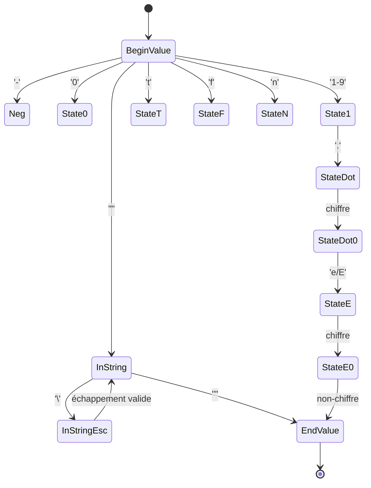
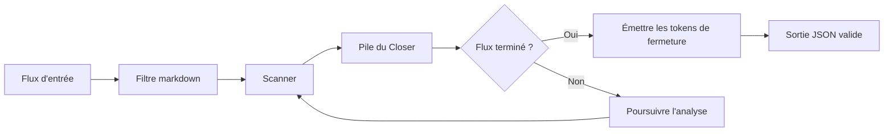

## Le problème : réanalyser un buffer accumulé

Quand on parle de « streaming » avec un LLM, on reçoit en général les données par petits chunks via SSE (Server-Sent Events). Une approche naïve courante, en Go, ressemble à ceci :

1. Recevoir un nouveau chunk.
2. L'ajouter à un buffer `accumulator`.
3. Appeler `json.Unmarshal(accumulator, &target)`.
4. Mettre à jour l'UI ou l'état.

Bien que simple, ce schéma a un coût quadratique. À chaque nouveau chunk, la bibliothèque standard parcourt de nouveau *tout* le buffer accumulé (`json.Unmarshal` vérifie la validité de toute l'entrée avant de décoder quoi que ce soit). Les tailles ci-dessous sont illustratives, à raison d'un caractère par chunk :

```
Chunk 1: {"content": "H"           → Analyse de 15 octets
Chunk 2: {"content": "He"          → Analyse de 16 octets
Chunk 3: {"content": "Hel"         → Analyse de 17 octets
...
Chunk N: {"content": "Hello..."    → Analyse de 14+N octets
```

Pour une réponse de 10 Ko livrée en 100 chunks d'environ 100 octets, cela fait 100 parcours d'un buffer qui passe de 100 octets à 10 Ko : environ 505 Ko parcourus au total au lieu de 10 Ko. Le coût croît comme le carré de la taille de l'entrée. Dans le benchmark comparatif plus bas, chaque multiplication de la taille de l'entrée par ~4 coûtait ~15 fois plus de temps (4² = 16).

## La solution : une machine à états reprenable

Pour y remédier, j'ai construit [go-llm-stream](https://github.com/camilbenameur/go-llm-stream). Au lieu de réanalyser, il utilise une **machine à états au niveau de l'octet** qui traite chaque octet exactement une fois.

### Architecture de la machine à états

Le scanner est adapté de la machine à états du scanner d'`encoding/json`, dans la bibliothèque standard de Go. La différence est que l'état est une énumération explicite au lieu d'un pointeur de fonction, ce qui permet de le sauvegarder et de le restaurer entre deux chunks. Il compte 31 états. Voici une vue simplifiée des transitions :



### Les 31 états

Le scanner mémorise précisément où l'analyse s'est arrêtée, avec des états organisés en groupes logiques :

```go
// Extrait de scanner/state.go : les états, adaptés du scanner de la stdlib Go
const (
    // États d'entrée de valeur
    StateBeginValue         State = iota // Début de n'importe quelle valeur
    StateBeginValueOrEmpty               // Après '[', attend une valeur ou ']'
    StateBeginStringOrEmpty              // Après '{', attend une clé ou '}'
    StateBeginString                     // Attend une clé d'objet

    // États d'analyse des chaînes (6)
    StateInString      // Dans un littéral de chaîne
    StateInStringEsc   // Après '\' dans une chaîne
    StateInStringEscU  // Après '\u'
    StateInStringEscU1 // Après '\uX'
    StateInStringEscU2 // Après '\uXX'
    StateInStringEscU3 // Après '\uXXX'

    // États d'analyse des nombres (8)
    StateNeg   // Après '-'
    State0     // Après un '0' initial
    State1     // Après un chiffre non nul
    StateDot   // Après le point décimal '.'
    StateDot0  // Après les chiffres décimaux
    StateE     // Après 'e' ou 'E'
    StateESign // Après le signe de l'exposant
    StateE0    // Après les chiffres de l'exposant

    // États d'analyse des littéraux : true (3)
    StateT   // Après 't'
    StateTr  // Après 'tr'
    StateTru // Après 'tru'

    // États d'analyse des littéraux : false (4)
    StateF    // Après 'f'
    StateFa   // Après 'fa'
    StateFal  // Après 'fal'
    StateFals // Après 'fals'

    // États d'analyse des littéraux : null (3)
    StateN   // Après 'n'
    StateNu  // Après 'nu'
    StateNul // Après 'nul'

    // États de fin
    StateEndValue // Après la fin d'une valeur
    StateEndTop   // Après la fin de la valeur de niveau supérieur
    StateError    // État d'erreur (terminal)
)
```

### Comment fonctionne la reprise

Quand un chunk arrive, le scanner reprend exactement là où il s'était arrêté (au milieu d'une chaîne, d'un nombre ou d'un objet) et poursuit :

```go
// Les frontières entre chunks sont invisibles pour l'appelant : le scanner conserve son état entre deux lectures
for token := range healer.Tokens() {
    process(token)
}
```

Chaque octet n'est parcouru qu'une fois, donc le travail croît linéairement avec la taille de l'entrée, contrairement à la réanalyse du buffer accumulé à chaque chunk. (`encoding/json.Decoder` est lui aussi linéaire, voir la comparaison plus bas.) Comme l'état est une petite valeur, le `Scanner` de bas niveau peut aussi le sauvegarder (`Snapshot`) puis le recharger plus tard (`Restore`), ce qui permet de persister l'état de l'analyseur en cours de flux et de reprendre à partir de là.

## Allocations

En Go, la performance ne dépend pas seulement de la complexité algorithmique : les allocations coûtent aussi du travail au GC. go-llm-stream garde ses objets `Scanner`, `Tokenizer`, `Closer` et `Healer`, ainsi que les buffers qu'ils portent, dans des `sync.Pool` pour les réutiliser au lieu de les réallouer. Cela ne rend pas tout sans allocation. Dans le tableau ci-dessous, le `Scanner` au niveau de l'octet (alimenté avec un buffer contigu), le `Closer` et le retrait du markdown n'allouent rien ; le tokenizer, les readers et le healer, eux, allouent encore.

### Résultats des benchmarks

Résultats choisis du fichier `docs/PERFORMANCE.md` de la bibliothèque (exécution du 25 janvier 2026 : AMD Ryzen 5 7600X, Debian 12 dans un Dev Container, Go 1.24+ ; le conteneur peut coûter un peu de vitesse par rapport au bare metal). Le document les attribue à la v1.3.0, mais l'exécution est antérieure à cette version (15 juin 2026), dont le changelog signale moins d'allocations pour `StreamReaderSmall` (de 25 à 23 allocs/op). Le document compte 17 lignes ; je montre d'abord le cœur sans allocation, puis les éléments de plus haut niveau :

| Benchmark | Opérations | ns/op | Mo/s | B/op | allocs/op |
|:----------|:----------:|------:|-----:|-----:|----------:|
| ScannerSmall | 13 636 113 | 85,37 | 316,28 | 0 | 0 |
| ScannerMedium | 131 680 | 8 481 | 318,60 | 0 | 0 |
| Closer_Feed | 6 425 085 | 180,5 | 448,84 | 0 | 0 |
| StripMarkdown | 1 709 116 | 700,4 | 115,64 | 0 | 0 |
| TokenizerSmall | 3 910 642 | 316,9 | 85,20 | 184 | 9 |
| StreamReaderSmall | 418 035 | 2 953 | 14,56 | 5 061 | 25 |
| Healer_Healing | 1 317 870 | 898,1 | 89,08 | 160 | 2 |

**Ce que ça montre** : le `Scanner` au niveau de l'octet, alimenté avec un buffer contigu, n'alloue rien et tourne à environ 316 Mo/s. `ScannerSmall` lui fait passer un document de 27 octets, octet par octet : c'est donc un chiffre pour une petite entrée ; `ScannerMedium`, sur un document généré plus grand, donne environ 319 Mo/s. Dès que l'entrée passe par un `io.Reader` découpé en chunks (`StreamReaderSmall`), le débit est de 14,56 Mo/s et il y a des allocations. Un seul chiffre en Mo/s ne démontre pas un passage à l'échelle linéaire ; les chiffres de passage à l'échelle sont dans la comparaison plus bas.

### Un test de stress

Le test de stress (`docs/examples/stress_test/main.go`) fait passer 100 000 objets JSON (800 001 tokens, environ 13 Mo d'après mon calcul) dans tout le pipeline `stream.NewHealer` via un `io.Pipe`. Dans l'exécution consignée dans `PERFORMANCE.md` :

- **Durée totale** : ~700 ms (environ 19 Mo/s pour l'ensemble du pipeline, génération des données d'entrée du test comprise ; c'est mon calcul, pas un chiffre du document de benchmark)
- **Heap utilisé** : ~4 Mo, mesuré une seule fois à la fin de l'exécution
- **Allocations totales** : ~890 Mo, cumulées sur l'exécution

Le pipeline du healer n'est donc pas sans allocation : il a beaucoup alloué au total, et pourtant le heap utilisé à la fin était petit. Je n'ai testé qu'une seule taille d'entrée : cela montre que le heap reste petit sur 13 Mo d'entrée, pas que la mémoire est constante quelle que soit la taille.

## Réparation automatique

Un problème courant avec les sorties de LLM est qu'elles peuvent être coupées à cause de limites de tokens ou d'erreurs réseau, ce qui laisse un JSON invalide comme celui-ci :

```json
{"status": "succe
```

### Avant : JSON cassé

```go
// json.Unmarshal seul : renvoie une erreur
resp := `{"status": "succe`
var result map[string]any
json.Unmarshal([]byte(resp), &result) // ❌ Erreur : unexpected end of JSON input
```

### Après : JSON réparé automatiquement

```go
// Avec le Healer de go-llm-stream
healer := stream.NewHealer(ctx, strings.NewReader(resp))
defer healer.Close()
for token := range healer.Tokens() {
    // ✅ Produit des tokens valides, ferme automatiquement la chaîne et l'objet
}
// Reconstruit à partir des tokens : {"status": "succe"}  ← JSON valide, toujours coupé
```

Le Healer tient une pile des délimiteurs ouverts (`{`, `[`, `"`) et les ferme automatiquement quand le flux se termine prématurément. Il complète aussi un littéral partiel (`tru` devient `true`). Le résultat est du JSON valide, pas la réponse complète : la chaîne ci-dessus reste coupée à `succe`, et une clé d'objet complète qui n'est pas encore suivie d'un deux-points ni d'une valeur, comme dans `{"a"`, reçoit la valeur de remplacement `"null"` (une chaîne).



### Options de configuration du Healer

```go
// Extrait de healer/healer.go (v1.3.0)
type HealerOptions struct {
    StripMarkdown      bool // Filtre les blocs de code ```json
    AutoClose          bool // Ferme automatiquement les conteneurs non fermés
    IgnoreTrailingJunk bool // Ignore le contenu après la fermeture de la racine
}
```

Les trois sont à `true` par défaut. Fermer les chaînes non terminées et compléter les littéraux partiels fait partie de ce que fait `AutoClose`. Une version précédente de cet article listait deux options de plus, `CompleteStrings` et `CompleteLiterals`. Elles n'ont jamais été branchées et ont été supprimées dans la v1.3.0, et `IgnoreTrailingJunk` ne faisait rien jusqu'à cette version ([changelog](https://github.com/camilbenameur/go-llm-stream/blob/main/CHANGELOG.md)).

## Comparaison avec la bibliothèque standard (corrigée)

`encoding/json.Decoder`, l'API de streaming idiomatique, est en O(n). Il ne réanalyse pas le buffer à chaque chunk. L'explosion quadratique n'apparaît que dans le schéma « accumuler puis réanalyser » du début de cet article. Pour le vérifier, j'ai comparé trois approches sur la même entrée : une seule grande valeur JSON (d'environ 4 Ko, 16 Ko et 64 Ko) livrée par chunks de 32 octets (Windows 11, amd64, Ryzen 5 7600X, 15 juin 2026 ; une configuration différente de celle du tableau ci-dessus, un hôte Windows plutôt qu'un Dev Container Linux sur le même modèle de CPU, donc les valeurs absolues ne sont pas comparables entre les deux) :

| Approche | 4 196 o | 16 494 o | 65 595 o | Croissance pour ~4x l'entrée |
|:---------|--------:|---------:|---------:|:---------------------|
| Réanalyse naïve du buffer accumulé | 584 893 ns | 8 867 734 ns | 134 908 188 ns | ~15x (quadratique) |
| `encoding/json.Decoder` | 67 729 ns | 262 476 ns | 1 126 186 ns | ~4x (linéaire) |
| go-llm-stream `StreamReader` | 205 956 ns | 780 371 ns | 3 085 429 ns | ~4x (linéaire) |

Les deux approches de streaming sont linéaires. `Decoder` est aussi plus rapide en valeur absolue : environ 2 à 3 fois par opération dans ce benchmark (1,13 ms contre 3,09 ms à 65 595 octets), même si `StreamReader` s'en sort relativement mieux avec des chunks de 64 octets. Je ne choisirais donc pas go-llm-stream pour la vitesse. Il trouve sa place là où la bibliothèque standard n'a pas d'équivalent : réparer une sortie tronquée ou entourée de blocs de code markdown, et sauvegarder et restaurer l'état du scanner. `Decoder.Token` peut aussi lire un flux token par token, mais il ne peut ni réparer une entrée cassée ni reprendre à partir d'un état sauvegardé.

## Utilisation

```go
import "github.com/camilbenameur/go-llm-stream/stream"

// responseBody est un io.Reader de la sortie du modèle (éventuellement tronquée ou entourée de blocs de code)
// contenant une valeur JSON, par exemple une réponse en sortie structurée.
healer := stream.NewHealer(ctx, responseBody)
defer healer.Close()

for token := range healer.Tokens() {
    if token.Kind == stream.TokenString {
        fmt.Print(string(token.Raw)) // chaque token chaîne, une fois complet
    }
}
```

Pour des réponses SSE brutes de style OpenAI ou Anthropic, le paquet `openai` décode les événements et vous remet les deltas de contenu (`openai.NewStream(ctx, body)`, puis `NextDelta()`) ; voir `docs/examples/openai` dans le dépôt.

## Conclusion

go-llm-stream est une petite bibliothèque qui fait quelques choses que la bibliothèque standard ne fait pas : elle répare le JSON tronqué ou entouré de blocs de code markdown, et elle peut sauvegarder et restaurer l'état du scanner. Elle émet aussi les champs au fur et à mesure qu'ils sont complets, ce que `Decoder.Token` sait aussi faire, token par token. Dans mon benchmark, elle est plus lente que `encoding/json.Decoder` sur une entrée découpée en chunks, et les benchmarks ci-dessus ne couvrent que l'analyseur : ils ne disent rien de la latence de bout en bout ni de l'usage CPU dans une application LLM.

Les principales décisions de conception :

1. **Conception en machine à états** : 31 états énumérés remplacent les pointeurs de fonction, pour que l'état puisse être sauvegardé et restauré
2. **Objets mis en pool** : `sync.Pool` pour le Scanner, le Tokenizer, le Closer et le Healer ; dans les benchmarks ci-dessus, le scanner, le closer et le retrait du markdown n'allouent rien, alors que le tokenizer, les readers et le healer allouent encore
3. **Réparation défensive** : suivi des délimiteurs par une pile pour fermer la sortie tronquée
4. **Parcours linéaire** : chaque octet n'est parcouru qu'une fois
5. **Fuzzing** : le scanner et le healer sont testés par fuzzing et recoupés avec `encoding/json.Valid` ; le fuzzing a trouvé de vrais bugs (nombres dans des conteneurs, clés d'objet orphelines), corrigés dans la v1.3.0

Si vous avez besoin de réparer du JSON de LLM tronqué ou entouré de blocs de code, de lire des champs avant qu'une valeur soit complète, ou de reprendre à partir d'un état de scanner sauvegardé, le projet est sur GitHub : **[go-llm-stream](https://github.com/camilbenameur/go-llm-stream)**. Si votre JSON est bien formé, `encoding/json` est le meilleur outil.

## Modifications apportées à cet article (29 septembre 2026)

La note en haut de la page donne la correction principale. Voici les autres changements principaux :

- le titre, qui promettait un résultat d'optimisation que les benchmarks ne soutiennent pas
- la comparaison avec la bibliothèque standard : le tableau que j'avais présenté à l'origine (environ 500 analyses pour 1 Mo) n'a jamais été mesuré, et il est remplacé par des chiffres mesurés
- les options du Healer : deux des cinq que j'avais listées n'ont jamais été branchées et ont été supprimées dans la v1.3.0, et une troisième, `IgnoreTrailingJunk`, ne faisait rien jusqu'à cette version
- le nombre d'états (31, et non 27) et la mention du scanner de la bibliothèque standard dont il est adapté
- les affirmations sur `sync.Pool`, l'absence d'allocation et la mémoire, ainsi que les conditions des benchmarks
- le calcul de l'exemple de réanalyse, qui était faux, et la description du test de stress
- l'exemple d'utilisation, qui ne compilait pas
- une affirmation sur une utilisation CPU et une latence plus faibles, que je n'ai jamais mesurées

Détails et chiffres : [PERFORMANCE.md](https://github.com/camilbenameur/go-llm-stream/blob/main/docs/PERFORMANCE.md#comparison-with-the-standard-library-corrected).

---

*Je suis Camil, ingénieur logiciel à Nice, en France. Vous pouvez me retrouver sur [GitHub](https://github.com/camilbenameur) et [LinkedIn](https://www.linkedin.com/in/camil-benameur-14a762194/).*
