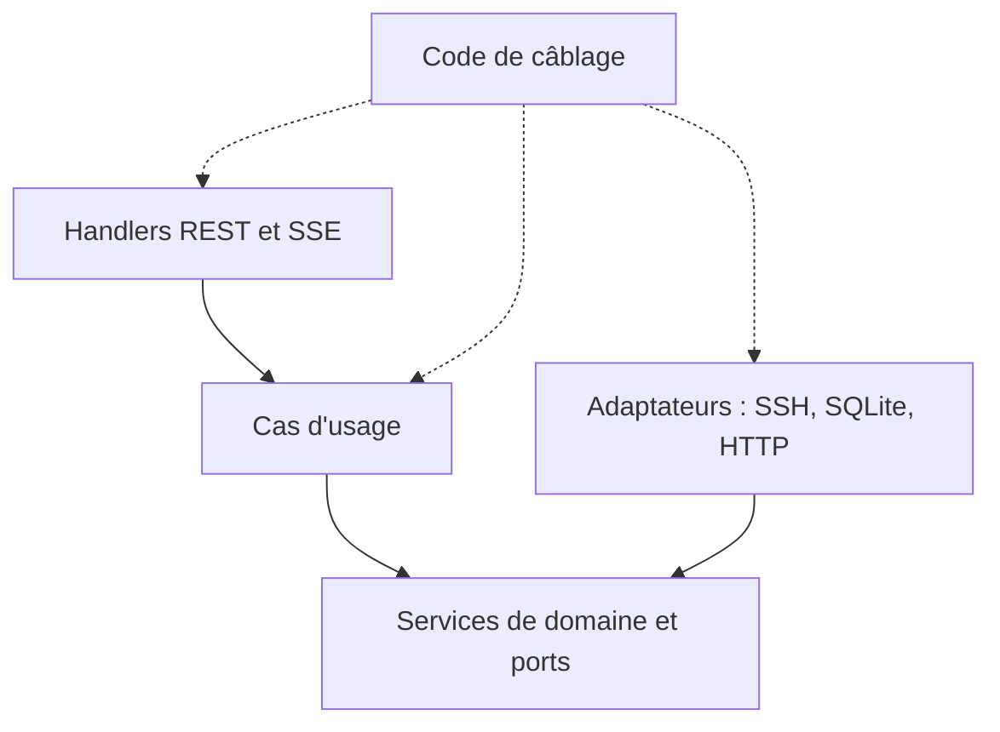
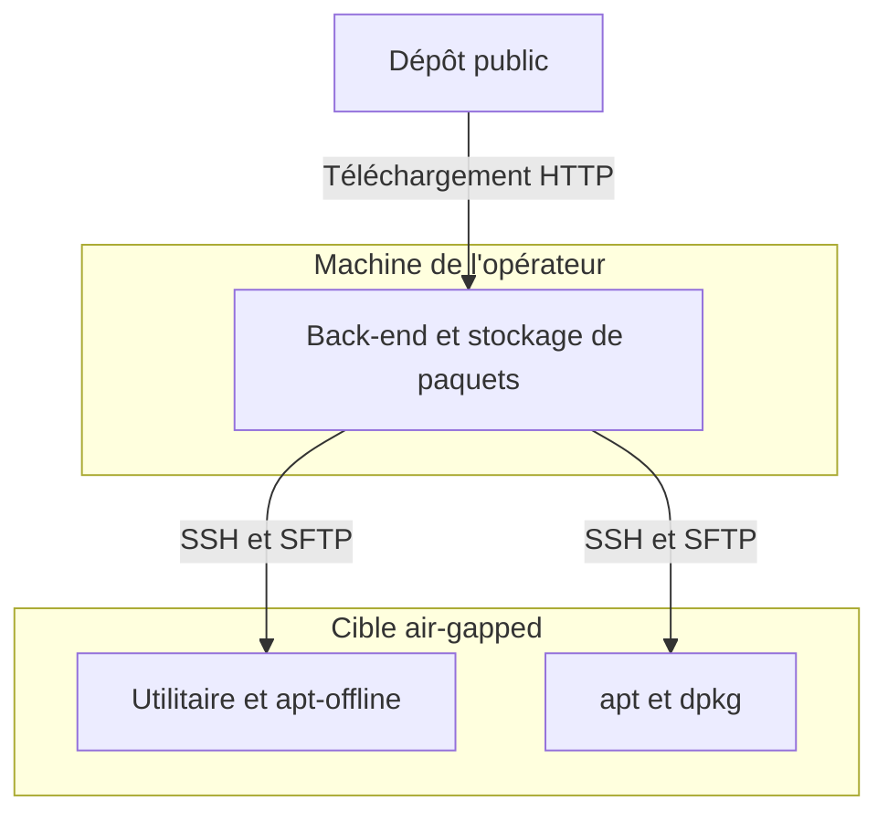

## Ce que l'installateur doit faire

Cet article explore le fonctionnement interne de l'installateur que j'ai décrit dans [l'article de février](/fr/blog/from-backlog-to-offline-installer/). Il déploie un logiciel d'automatisation industrielle sur des PC industriels qui n'ont souvent pas d'accès à internet, et il le fait via SSH. Voici comment je l'ai construit, et ce que je jugerais différemment aujourd'hui.

Les cibles sont des machines Linux basées sur apt, accessibles en SSH. Souvent, la machine de l'opérateur est la seule à avoir accès à internet : elle sert alors de relais, elle télécharge les paquets et les pousse vers la cible. Si la cible est en ligne, apt résout lui-même les dépendances.

Une exécution complète comporte sept étapes : un test SSH, une vérification de la connectivité, l'installation des outils, Docker, une introspection de ce qui manque, l'installation des dépendances, et l'installation du produit. La progression en direct arrive dans le navigateur via des Server-Sent Events, et non des WebSockets. Le back-end est volumineux, et cette taille fait partie de l'histoire.

## Quatre couches et une règle de dépendance qui a tenu

Le back-end a quatre couches : le domaine, l'application, l'infrastructure et les interfaces REST. Le sens des imports a tenu : le domaine ne dépendait d'aucune autre couche, et la couche REST n'accédait pas directement à l'infrastructure. Les exceptions étaient le code de câblage et quelques endroits qui lisent la configuration globale.



Les ports sont l'endroit où la conception est la plus visible. L'accès SSH est découpé en petits ports (connexion, commande, transfert de fichiers, etc.), et la plupart des consommateurs ne demandent que le composite étroit dont ils ont besoin. Au-dessus se trouvent des dizaines de ports de capacité qui parlent le langage du domaine, comme « vérifier l'installation de Docker ».

Une chose que j'ai remarquée tard : beaucoup de logique d'orchestration vivait dans des services de domaine plutôt que dans des cas d'usage, si bien que le domaine est devenu lourd. Les couches sont restées séparées, mais les responsabilités à l'intérieur se sont brouillées, et rien ne faisait respecter la règle sous forme de vérification.

### Une requête à travers les couches

Une requête de statut passe par le middleware HTTP et arrive sur un handler typé, qui appelle un cas d'usage. De là, elle traverse un dépôt (repository), un service de domaine, un port et un adaptateur qui exécute une commande sur un client SSH issu d'un pool. Cela fait beaucoup de sauts pour une seule question. Les couches sont bien réelles, et le coût de lecture aussi.

## Le pipeline d'installation et la progression en direct

Le pipeline est un cas d'usage de la couche application qui exécute les sept étapes dans l'ordre. Il s'arrête à la première erreur et n'a pas de rollback. Pour récupérer, on le relance, et les étapes déjà satisfaites (outils, Docker, dépendances) sont ignorées. Chaque étape passe par un seul wrapper qui émet `running`, puis `completed`, `skipped` ou `failed`, avec une durée. Chaque événement est enregistré dans SQLite, écrit dans le flux HTTP de l'exécution qui l'a déclenché, et publié sur un hub interne au processus pour toutes les autres fenêtres.

Deux détails méritent d'être retenus.

**La tâche survit à la requête.** Le pipeline est détaché avec `context.WithoutCancel`, ajouté après un bug : la déconnexion d'un client annulait le contexte de la requête et interrompait la dernière étape d'installation. Un garde-fou par appareil rejette une seconde exécution pour le même appareil, et comme le statut HTTP est déjà envoyé une fois le flux démarré, le rejet transite sous forme d'événement dans le flux.

**Les flux en POST demandent `fetch`.** `EventSource`, dans le navigateur, ne gère que GET. L'installation a besoin d'un corps POST, donc le front-end lit la réponse avec `fetch` et un lecteur de flux, et découpe lui-même les blocs SSE.

Les limites sont simples. Les sous-étapes sont des libellés statiques, pas une vraie progression, les abonnés lents peuvent manquer des événements, et « Annuler » dans l'interface interrompt le `fetch` du navigateur, pas l'installation, parce que la tâche est détachée volontairement.

## Survivre aux verrous d'apt et de dpkg

Sur une machine fraîchement démarrée, les verrous d'apt et de dpkg sont souvent tenus par des mises à jour en arrière-plan, si bien que les installations échouent pour des raisons sans rapport avec les paquets. L'installateur reconnaît un conflit de verrou en cherchant des phrases de message connues dans le texte de l'erreur. Toute autre erreur est renvoyée immédiatement. Les nouvelles tentatives utilisent un backoff exponentiel avec jitter, borné à une poignée de tentatives, et s'interrompent plus tôt si le contexte est annulé.

```go
// Esquisse simplifiée, pas le code d'origine.
func retryOnLock(ctx context.Context, maxRetries int, base time.Duration, op func() error) error {
	for attempt := 0; ; attempt++ {
		err := op()
		if err == nil || attempt >= maxRetries {
			return err
		}
		if !looksLikeLock(err.Error()) {
			return err
		}
		wait := base<<attempt + jitter(base)
		select {
		case <-ctx.Done():
			return ctx.Err()
		case <-time.After(wait):
		}
	}
}
```

L'étape Docker ajoute une cascade de repli par-dessus : nouvelle tentative, puis une routine de réparation au mieux (best effort), puis un installateur alternatif qui installe les paquets dans un ordre fixe. Un petit piège dans l'indicateur d'état « apt est occupé » : sur beaucoup de systèmes Ubuntu, `unattended-upgrades` paraît actif uniquement à cause d'un utilitaire d'arrêt sur inactivité, donc la sonde doit filtrer cet utilitaire.

## Le relais hors ligne : des paquets pour un appareil sans internet

C'est la partie la plus poussée du système. La machine de l'opérateur télécharge en HTTP et pousse les fichiers par SFTP. La cible n'a besoin que de SSH.



### Lire la cible

Le back-end lit sur la cible le nom de l'OS, la version, le nom de code et l'architecture, et en déduit les chemins de dépôt et les noms de fichiers `.deb`. Le chemin de téléchargement ne connaît que l'organisation du dépôt Ubuntu.

### Versions épinglées, en partie

Seuls les deux paquets Docker principaux étaient épinglés, et seulement par défaut ; les paquets d'appui étaient résolus en dernière version. Le stockage local de paquets ne distinguait pas toujours les versions, si bien qu'un paquet stocké pouvait être réutilisé pour une autre version.

### Le manifeste et le parcours des dépendances

Dans apt-offline, une « signature » est un manifeste. L'utilitaire demande à apt ce qu'il téléchargerait pour installer un paquet sur la cible, et comme apt calcule cela à partir de l'état réel des paquets de la cible, le manifeste ne liste que ce qui y manque. Cela s'exécute avec le réseau désactivé.

Le résolveur parcourt une file de paquets qui s'allonge, en préférant un `.deb` téléversé, puis le stockage local, puis un téléchargement, et traite tout ce qui reste non résolu comme un avertissement. L'installation est ensuite un unique `apt install` des fichiers préparés, enveloppé dans la nouvelle tentative sur verrou décrite plus haut.

## Le shell et l'environnement de test

Le shell Tauri 2 est une fine couche de Rust. Il démarre le back-end Go comme sidecar embarqué et l'arrête à la fermeture de la fenêtre principale. Les builds tiennent dans un seul Dockerfile multi-étapes, et l'installateur Windows est construit depuis Linux. Le shell a des lacunes : pas de contrôle de disponibilité (readiness), et rien ne relance le back-end s'il plante.

Pour le comportement des appareils, l'environnement de test est un fichier Docker Compose avec des conteneurs qui font tourner systemd et un démon SSH : Ubuntu et Debian, chacun avec une variante « en ligne » et une variante « hors ligne ». Les variantes hors ligne sont sur un réseau déclaré `internal`, donc sans route vers l'extérieur, ce qui s'approche d'une cible air-gapped.

Côté Go, les tests utilisent des fakes écrits à la main pour les ports, avec des champs de type fonction pour qu'un test ne simule que ce dont il a besoin. La couverture était mince là où cela comptait : le vrai comportement SSH était surtout testé à la main, et les tests de bout en bout du front-end ne faisaient pas partie d'un pipeline automatisé.

## Le volume a dépassé la relecture

Place à la seconde moitié. Un back-end aussi volumineux était difficile à garder cohérent, et ça s'est vu.

**Construit mais jamais branché.** Une quantité non négligeable de code Go n'était jamais appelée. Un exemple : une implémentation alternative des opérations groupées, sans appelant, parce que la fonctionnalité d'opérations groupées réellement utilisée composait à la place les handlers REST. Une partie du code du front-end n'était jamais utilisée non plus. Je ne l'ai remarqué que tard.

**Une couture laissée ouverte.** Le service d'installation de Docker avait des dépendances qui n'ont jamais été injectées, avec un chemin de repli qui s'est avéré être celui qui s'exécutait réellement.

## Trois façons de câbler une seule application

L'application était câblée de trois façons à la fois : une longue fonction de composition qui construit les choses en ligne, une fabrique à interface fluide qui construit la plupart des cas d'usage, et un registre d'adaptateurs, plus de l'état au niveau des packages pour la configuration. Le résultat : des instances dupliquées. Les adaptateurs sont fins et sans état, donc ces doublons étaient inoffensifs, mais certains services se sont retrouvés construits plusieurs fois, sans partager leur état.

Les tests n'ont pas aidé. Certains tests vérifiaient seulement que des choses existaient, ce qui protège la forme du code, pas son comportement, et peut figer du code mort sur place. Rien n'exerçait le câblage complet, donc une erreur de câblage ne ferait échouer aucun test.

## Quand « vert » ne voulait pas dire « réussi »

Cette section porte sur des étapes qui signalaient un succès alors qu'elles avaient échoué. Sur ce projet, un écran de progression qui affiche du vert sur une étape en échec est pire que pas d'écran du tout.

Le résultat des étapes était signalé de façon incohérente, si bien qu'une étape pouvait s'afficher en vert malgré un échec, et la couche de nouvelle tentative ne distinguait pas toujours une connexion morte d'une commande échouée.

```go
// Esquisse illustrative de ce que j'écrirais, pas du code du projet.
type Result struct {
	ExitCode int
	Stdout   string
	Stderr   string
}

// Run retourne une erreur uniquement quand le transport échoue.
type Executor interface {
	Run(ctx context.Context, cmd string) (Result, error)
}

func statusOf(res Result, err error) Status {
	switch {
	case err != nil:
		return Retryable // on peut réessayer sans risque sur une nouvelle connexion
	case res.ExitCode != 0:
		return Failed // une réponse : ne pas relancer à l'aveugle
	default:
		return Succeeded
	}
}
```

Les vérifications de build et de CI étaient trop permissives : certains échecs n'arrêtaient pas le pipeline, et la CI est arrivée tard.

## Construire avec des agents de code IA : ce que ça a laissé derrière

Le projet contenait des instructions pour des agents et beaucoup de documents de planification. Je ne prétends rien sur la part du code écrite par des agents. Ce que je peux décrire, c'est ce qu'ils ont laissé derrière eux.

L'effet visible a été le volume. À la fin, les notes de planification étaient devenues très volumineuses et deux systèmes de planification coexistaient. Il faut que quelqu'un lise tout cela et le garde synchronisé.

Un plan peut aussi se tromper discrètement. Un plan supposait que le contexte de la requête pouvait simplement être transmis à travers le pipeline. Le client SSH ne lit pas son contexte, mais d'autres couches le faisaient, donc une déconnexion du navigateur interrompait la dernière étape d'installation, le bug à l'origine de la tâche détachée décrite plus haut. Un plan écrit vite a besoin d'une étape qui confronte ses hypothèses au code.

Les règles écrites dans un fichier d'instructions n'étaient pas toujours suivies par le code. Une règle écrite montre une intention, pas la conformité, et la responsabilité reste à l'ingénieur.

## Ce que je ferais autrement

Ces points sont propres à ce projet.

1. **Rendre la CI bloquante dès le premier commit.** Commencer avec un petit ensemble capable d'échouer, et garder l'envoi des rapports séparé du code de sortie. Une vérification qui ne peut pas échouer est un rapport, pas une barrière.
2. **Finir une tranche verticale, puis écrire une seule racine de composition.** Construire une fonctionnalité de bout en bout avant les couches autour, et construire chaque service partagé une seule fois, avec un test qui le vérifie.
3. **Exiger les ports à la construction.** Un constructeur qui rejette `nil` transforme un TODO discret en échec au démarrage. Ajouter une détection de code mort pour que « construit mais non référencé » fasse échouer une vérification.
4. **Traiter les résultats comme des données.** Un seul canal d'échec par couche, de nouvelles tentatives uniquement sur les erreurs de transport, et le contexte transmis à l'appel SSH pour que les timeouts s'appliquent réellement.
5. **Transformer les règles écrites en vérifications.** Un court test du graphe d'imports détecterait la dérive des couches, ce que les commentaires ne peuvent pas faire.
6. **Garder un seul système de planification.** L'élaguer à chaque jalon, garder les notes générées hors de l'arborescence principale, et garder un README d'une page comme contrat.

Ce qu'il faut retenir est restreint. Sur ce projet, les frontières entre couches ont tenu, surtout par convention. Ce qui ne reposait que sur la discipline a dérivé : le câblage, le statut des étapes, la CI.

---

*Je suis Camil, ingénieur à Nice, en France. Vous pouvez me retrouver sur [GitHub](https://github.com/camilbenameur) et [LinkedIn](https://www.linkedin.com/in/camil-benameur-14a762194/).*
